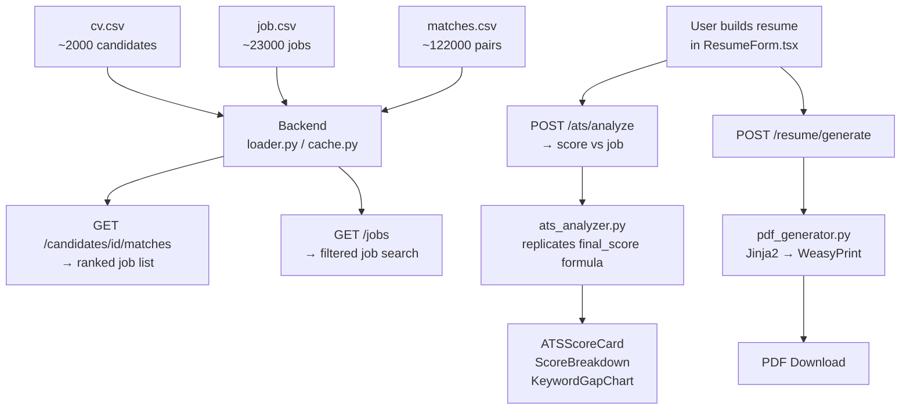

# ATS Resume Generator — File Structure (CSV-Based)

> **Stack:** React + TypeScript (Frontend) · Python/FastAPI (Backend) · PDF Generation
> **Data Source:** 3 CSV files in `src/assets/` drive all matching and scoring logic
---

## 📊 Your CSV Data — What Each File Contains

| File                                                                                              | Rows    | Purpose in App                                                 |
| ------------------------------------------------------------------------------------------------- | ------- | -------------------------------------------------------------- |
| [`cv.csv`](file:///c:/Users/Rohit/OneDrive/Desktop/sem-1-MiniProject/src/assets/cv.csv)           | ~2000   | Candidate resumes with skills, experience, education, category |
| [`job.csv`](file:///c:/Users/Rohit/OneDrive/Desktop/sem-1-MiniProject/src/assets/job.csv)         | ~23000  | Job listings with descriptions, required skills, category      |
| [`matches.csv`](file:///c:/Users/Rohit/OneDrive/Desktop/sem-1-MiniProject/src/assets/matches.csv) | ~122000 | Pre-computed match scores between candidates and jobs          |

### CV columns (`cv.csv`)

`candidate_id` · `target_position` · `resume_text` · `clean_skills_json` · `inferred_category` · `years_experience`

### Job columns (`job.csv`)

`job_id` · `job_title` · `category` · `job_description` · `clean_skills_json` · `years_required`

### Match columns (`matches.csv`)

`candidate_id` · `job_id` · `final_score` · `raw_score` · `label_strength` · `semantic_score` · `skill_score` · `position_score` · `category_score` · `experience_score` · `education_score` · `candidate_rank` · `candidate_rank_pct`

---

## Project Root

```
ats-resume-generator/
├── frontend/                   # React + TypeScript App (Vite)
├── backend/                    # Python FastAPI App
├── .gitignore
├── README.md
└── docker-compose.yml
```

---

## 🖥️ Frontend — `frontend/`

```
frontend/
├── public/
│   └── index.html
│
├── src/
│   ├── assets/
│   │   ├── cv.csv              # ~2000 candidate resumes
│   │   ├── job.csv             # ~23000 job listings
│   │   └── matches.csv         # ~122000 pre-scored match pairs
│   │
│   ├── components/
│   │   ├── common/
│   │   │   ├── Button.tsx
│   │   │   ├── Input.tsx
│   │   │   ├── Loader.tsx
│   │   │   ├── Badge.tsx       # skill_score / label_strength badges
│   │   │   └── Navbar.tsx
│   │   │
│   │   ├── resume/
│   │   │   ├── ResumeForm.tsx          # Build resume from scratch
│   │   │   ├── PersonalInfoSection.tsx
│   │   │   ├── SkillsSection.tsx       # Populates from cv.clean_skills_json
│   │   │   ├── ExperienceSection.tsx   # Maps to cv.years_experience
│   │   │   ├── EducationSection.tsx
│   │   │   └── ResumePreview.tsx       # Live preview
│   │   │
│   │   ├── ats/
│   │   │   ├── ATSScoreCard.tsx        # Renders final_score, label_strength
│   │   │   ├── ScoreBreakdown.tsx      # semantic/skill/position/exp scores
│   │   │   ├── KeywordGapChart.tsx     # Skills in job but missing from CV
│   │   │   └── JobMatchList.tsx        # Top ranked jobs from matches.csv
│   │   │
│   │   ├── jobs/
│   │   │   ├── JobSearch.tsx           # Filter job.csv by category/title
│   │   │   ├── JobCard.tsx             # job_title + clean_skills + score
│   │   │   └── JobDetailPanel.tsx      # Full job_description + match scores
│   │   │
│   │   └── templates/
│   │       ├── TemplateSelector.tsx
│   │       ├── MinimalTemplate.tsx
│   │       └── ModernTemplate.tsx
│   │
│   ├── pages/
│   │   ├── Home.tsx                    # Landing / category selector
│   │   ├── CandidateDashboard.tsx      # Look up candidate_id → matches
│   │   ├── BuildResume.tsx             # Build + download PDF
│   │   ├── ATSChecker.tsx              # Paste resume text → score vs job
│   │   ├── JobExplorer.tsx             # Browse job.csv with filters
│   │   └── NotFound.tsx
│   │
│   ├── hooks/
│   │   ├── useCSVData.ts               # Load & parse cv/job/matches CSVs
│   │   ├── useCandidateMatches.ts      # Filter matches.csv by candidate_id
│   │   ├── useJobSearch.ts             # Search/filter job.csv
│   │   └── useATSScore.ts             # Call backend /ats/analyze
│   │
│   ├── services/
│   │   ├── api.ts                      # Axios instance for backend calls
│   │   └── csvLoader.ts               # Papa Parse wrappers for 3 CSVs
│   │
│   ├── store/
│   │   ├── candidateStore.ts           # Selected candidate + their matches
│   │   ├── resumeStore.ts              # Form-built resume state
│   │   └── jobStore.ts                 # Loaded jobs + selected job
│   │
│   ├── types/
│   │   ├── candidate.ts                # CandidateRow (maps cv.csv columns)
│   │   ├── job.ts                      # JobRow (maps job.csv columns)
│   │   └── match.ts                    # MatchRow (maps matches.csv columns)
│   │
│   ├── utils/
│   │   ├── scoreHelpers.ts             # label_strength → color, percentile
│   │   ├── skillParser.ts              # Parse clean_skills_json string
│   │   └── formatters.ts              # Date, years_experience display
│   │
│   ├── styles/
│   │   ├── index.css
│   │   └── templates.css
│   │
│   ├── App.tsx
│   ├── main.tsx
│   └── routes.tsx
│
├── .env
├── tailwind.config.js
├── vite.config.ts
└── package.json
```

---

## 🐍 Backend — `backend/`

```
backend/
├── app/
│   ├── main.py                         # FastAPI entry point
│   ├── config.py                       # CORS, env vars
│   │
│   ├── api/
│   │   └── v1/
│   │       ├── resume.py               # POST /resume/generate → PDF
│   │       ├── ats.py                  # POST /ats/analyze → scores
│   │       ├── candidates.py           # GET /candidates/{id}/matches
│   │       └── jobs.py                 # GET /jobs?category=&title=
│   │
│   ├── schemas/
│   │   ├── candidate.py                # Pydantic model from cv.csv shape
│   │   ├── job.py                      # Pydantic model from job.csv shape
│   │   └── match.py                    # Pydantic model from matches.csv shape
│   │
│   ├── data/
│   │   ├── loader.py                   # Load cv/job/matches CSVs with pandas
│   │   └── cache.py                    # In-memory cache (DataFrames)
│   │
│   ├── services/
│   │   ├── pdf_generator.py            # Jinja2 → WeasyPrint → PDF bytes
│   │   ├── ats_analyzer.py             # Score resume vs job description
│   │   │                               #   uses skill_score, semantic_score
│   │   │                               #   logic from matches.csv columns
│   │   ├── match_service.py            # Query matches.csv by candidate/job
│   │   └── keyword_extractor.py        # Extract skills from raw resume text
│   │
│   ├── templates/
│   │   ├── minimal.html
│   │   └── modern.html
│   │
│   └── utils/
│       ├── score_utils.py              # Replicate final_score formula
│       └── text_cleaner.py
│
├── data/                               # Backend copy of CSVs (or symlink)
│   ├── cv.csv
│   ├── job.csv
│   └── matches.csv
│
├── tests/
│   ├── test_ats.py
│   ├── test_match_service.py
│   └── test_pdf.py
│
├── requirements.txt
├── .env
└── Dockerfile
```

---

## 🔄 Key API Contracts

| Method | Endpoint                                    | Maps to CSV                                          |
| ------ | ------------------------------------------- | ---------------------------------------------------- |
| `GET`  | `/api/v1/candidates/{candidate_id}/matches` | `matches.csv` filtered by `candidate_id`             |
| `GET`  | `/api/v1/jobs?category=IT&title=Engineer`   | `job.csv` filtered + paginated                       |
| `POST` | `/api/v1/ats/analyze`                       | Scores text vs job using `matches.csv` scoring logic |
| `POST` | `/api/v1/resume/generate`                   | Resume JSON → PDF download                           |

---

## 🎯 Score Columns Explained (`matches.csv`)

| Column               | Description                                             | UI Use                 |
| -------------------- | ------------------------------------------------------- | ---------------------- |
| `final_score`        | Weighted overall score (0–1)                            | Main ATS score badge   |
| `label_strength`     | `strong_positive` / `medium_positive` / `weak_positive` | Color-coded label      |
| `semantic_score`     | Sentence-level semantic similarity                      | "Content match" bar    |
| `skill_score`        | Exact/fuzzy skill overlap                               | "Skills match" bar     |
| `position_score`     | Title/role alignment                                    | "Role match" bar       |
| `experience_score`   | Years experience vs required                            | "Experience match" bar |
| `education_score`    | Education level match                                   | "Education match" bar  |
| `candidate_rank`     | Rank vs all candidates for that job                     | "You rank #N"          |
| `candidate_rank_pct` | Percentile (0–1)                                        | "Top X%" display       |

---

## 📦 Core Dependencies

### Frontend

| Package            | Purpose                               |
| ------------------ | ------------------------------------- |
| `papaparse`        | Parse cv/job/matches CSVs in browser  |
| `zustand`          | Global state (candidate, job, resume) |
| `axios`            | Backend API calls                     |
| `tailwindcss`      | Styling                               |
| `react-router-dom` | Routing                               |
| `recharts`         | Score breakdown charts                |

### Backend

| Package               | Purpose                                 |
| --------------------- | --------------------------------------- |
| `fastapi` + `uvicorn` | Web framework                           |
| `pandas`              | Load and query CSVs                     |
| `pydantic`            | Schema validation                       |
| `weasyprint`          | PDF generation                          |
| `jinja2`              | HTML templates for PDF                  |
| `scikit-learn`        | TF-IDF / cosine similarity for live ATS |

---

## 🏗️ Data Flow


